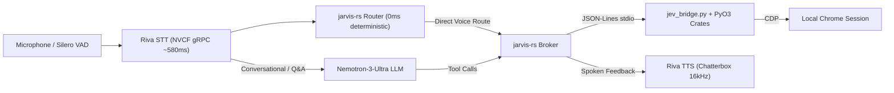

# Jarvis Handoff Document

## 1. Repository & Git Status
- **Remote:** `https://github.com/hackerabi2005/ai.git` (`main`)
- **Author:** `hackerabi2005 <abishekji2005@gmail.com>`
- **Latest Commit:** `851696c` (`Fix s2s startup latency and auto-launch Chrome when closed`)
- **Language Breakdown:** Configured via [.gitattributes](file:///c:/Users/Abish/Desktop/combinned%20jarvis/.gitattributes) so GitHub Linguist reports **100% Rust** across `jarvis-rs/` and `rust/`, while marking vendored/generated Python bindings accordingly. Over 230 unused Python/JS/HTML files (`-102,220` lines) were removed.

---

## 2. Architecture Overview



### Core Components
1. **Rust Supervisor & Voice Router (`jarvis-rs/`)**
   - [supervisor.rs](file:///c:/Users/Abish/Desktop/combinned%20jarvis/jarvis-rs/src/supervisor.rs): Launches the local loopback tool API (`127.0.0.1`), warms Chrome in a non-blocking background `tokio::spawn` task, injects all 9 PyO3 crates into `PYTHONPATH`, and supervises the `speech-to-speech` runtime and `jev_bridge.py`.
   - [router.rs](file:///c:/Users/Abish/Desktop/combinned%20jarvis/jarvis-rs/src/router.rs): Intercepts 40+ browser, media, tab, scroll, zoom, search, and appearance voice commands in `<1ms` without waiting for an LLM round-trip.
   - [broker.rs](file:///c:/Users/Abish/Desktop/combinned%20jarvis/jarvis-rs/src/broker.rs): Executes fast opens, instant DOM click matching (`match_click`), context-aware site searches, and background Jev step loops (`MAX_STEPS = 60`).
   - [policy.rs](file:///c:/Users/Abish/Desktop/combinned%20jarvis/jarvis-rs/src/policy.rs): Enforces confirmation gates on sensitive actions (checkout, purchase, payment, delete, account changes, credential fields).

2. **PyO3 Rust Port Crates (`rust/`)**
   - Mapped in [PORT_MAP.md](file:///c:/Users/Abish/Desktop/combinned%20jarvis/rust/PORT_MAP.md) and unified in [rust/app/src/lib.rs](file:///c:/Users/Abish/Desktop/combinned%20jarvis/rust/app/src/lib.rs):
     - `rust/jev-ultrafast-rs` (`fingerprint`, `validate_choice`, `action_space`, `field_context`) — `340/340` cases
     - `rust/python-rs` (`page_summary`, `classify_error`) — `209/209` cases
     - `rust/llm-rs` (`build_text_system_prompt`, `remove_markdown`, `remove_unspeechable`, `format_language_instruction`, `language_name_for_prompt`, `resolve_auto_language`, `build_voice_system_prompt`) — `1,603/1,603` cases
     - `rust/tool-call-rs` (`find_json_tool_call_end`, `build_block_regex`) — `464/464` cases
     - `rust/stt-rs` (`clean_transcript`, `build_prompt`) — `477/477` cases
     - `rust/tts-rs` (`number_to_words`, `numbers_to_words`, `normalize`) — `470/470` cases
     - `rust/utils-rs` (`safe_identifier`, `next_power_of_2`, `validate_device`) — `276/276` cases
     - `rust/speech-languages-rs` (`normalize_language`) — `67/67` cases
     - `rust/pipeline-rs` (`set_log_transcripts`, `transcript_for_log`) — `21/21` cases
   - **Total Differential Verification:** `3,927/3,927` cases passing (`0` mismatches), `12/12` `rust-anything gate` checks passing per crate.

---

## 3. Bugs & Latency Bottlenecks Resolved

### A. Startup & Chrome Connection
- **Auto-Launch Chrome When Closed ([jev_bridge.py](file:///c:/Users/Abish/Desktop/combinned%20jarvis/jarvis-rs/python/jev_bridge.py#L691-L706)):**
  - `browser_harness/admin.py` had an unreachable `_launch_browser()` branch when the daemon exited with `fatal: chrome-not-running` (`pending_died` triggered `continue` before `_launch_browser()`).
  - Added `_ensure_chrome_running()` before `ensure_daemon()` in `warm_browser`, `_try_attach_existing_tab`, and `_open` to automatically launch Chrome if no Chromium process is running.
- **9-Second Faster Voice Pipeline Startup ([s2s_pipeline.py](file:///c:/Users/Abish/Desktop/combinned%20jarvis/s2s/speech-to-speech/src/speech_to_speech/s2s_pipeline.py#L1-L238)):**
  - Removed unused top-level `import nltk` and moved `from transformers import HfArgumentParser` lazily into CLI parser functions so YAML startup (`-f jarvis_s2s.yaml`) skips loading `transformers` and `nltk` at import time.
- **Missing `enable_visemes` After STV Cleanup ([module_arguments.py](file:///c:/Users/Abish/Desktop/combinned%20jarvis/s2s/speech-to-speech/src/speech_to_speech/arguments_classes/module_arguments.py#L229)):**
  - Restored `enable_visemes: bool = False` on `ModuleArguments` after removing the unused `STV/` directory.

### B. Riva STT Latency & Reliability
- **3.3x Faster NVCF Unary gRPC ([riva_stt_handler.py](file:///c:/Users/Abish/Desktop/combinned%20jarvis/s2s/speech-to-speech/src/speech_to_speech/STT/riva_stt_handler.py#L46-L154)):**
  - Enabled `enable_automatic_punctuation=True` (benchmarked on NVCF Parakeet CTC at `489ms–586ms` vs `1910ms` with punctuation disabled).
  - Replaced all-zero warmup bytes (`np.zeros(16000)`, which caused NVCF Parakeet CTC to hang past `2.5s` with `DEADLINE_EXCEEDED`) with `0.25s` of dithered PCM (`b"\x01\x00\xff\xff" * 2000`) executed synchronously during `warmup()`.
  - Added a `6.0s` unary gRPC timeout with automatic gRPC channel reset on `RpcError` and restored the NVCF HTTP fallback URL in [jarvis_s2s.yaml](file:///c:/Users/Abish/Desktop/combinned%20jarvis/jarvis-rs/config/jarvis_s2s.yaml#L39-L43).

### C. Browser CDP & Navigation Speed
- **Eliminated 5-Second Post-Click CDP Hang ([browser.py](file:///c:/Users/Abish/Desktop/combinned%20jarvis/borwse%20harness/jev-ultrafast/jev_ultrafast/browser.py#L510-L545)):**
  - `Browser.observe()` previously ran a 150ms `Runtime.evaluate(..., awaitPromise=True)` promise after every click or fill. When a click triggered a page navigation (e.g., clicking a Google result to open YouTube), Chrome destroyed the execution context mid-promise, causing `browser-harness` to block for 5,000ms and throw `RuntimeError: Runtime.evaluate timed out after 5s waiting for the daemon`.
  - Restricted the `awaitPromise=True` autocomplete waiter strictly to `fill` actions on `role="combobox"`, using a fast `25ms` sleep for clicks.
- **Navigation & Concurrent Media Control Recovery ([jev_bridge.py](file:///c:/Users/Abish/Desktop/combinned%20jarvis/jarvis-rs/python/jev_bridge.py#L76-L89), [jev_bridge.py](file:///c:/Users/Abish/Desktop/combinned%20jarvis/jarvis-rs/python/jev_bridge.py#L1141-L1195)):**
  - Treated `Runtime.evaluate timed out` and `Page.navigate timed out` as transient navigation errors (`_is_transient_nav_error`) so post-click navigation never resets the session as `chrome_not_ready`.
  - Treated `ValueError("Observe and choose before acting")` (when a direct media/scroll command invalidates a pending prediction mid-step) as a clean `stale: True` retry.
  - Auto-dispatched `Enter` after filling a search box when the goal starts with `"type "`, `"enter "`, or `"fill "`.

### D. Deterministic Voice Routing
- **Instant Local Appearance & Site Controls ([jev_bridge.py](file:///c:/Users/Abish/Desktop/combinned%20jarvis/jarvis-rs/python/jev_bridge.py#L740-L764), [router.rs](file:///c:/Users/Abish/Desktop/combinned%20jarvis/jarvis-rs/src/router.rs), [broker.rs](file:///c:/Users/Abish/Desktop/combinned%20jarvis/jarvis-rs/src/broker.rs)):**
  - Matched Wikipedia/page appearance radio controls (`"text small/large"`, `"set color light/dark/automatic"`, `"width wide"`) directly via `_match_clickable_action` in `~15ms` (`0` Jev API calls).
  - Added context-aware generic `"search <query>"` routing (`contextualize_generic_search`) so speaking `"search Python programming"` while on Wikipedia/YouTube/GitHub searches the active site immediately.
  - Added fast `open_fast` fallback in `Broker::click_target` when `"select/click <known_site>"` is not matched on the current page.
  - Added support for conversational prefixes before multi-tab close (`"Okay, thank you. Close three tabs."`), `"close this wikipedia"`, `"skip"` / `"skip skip skip"` (`skip_ad`), `"vol up"` / `"vol down"`, and verb-less `<query> in/on <site>` (`"mr beast in youtube"`).

---

## 4. How to Run & Verify

### Start Jarvis
```powershell
cargo run --manifest-path "c:\Users\Abish\Desktop\combinned jarvis\jarvis-rs\Cargo.toml" -- run
```
Wait for `Ready — start speaking.` and `ASSISTANT: Jarvis ready.` before speaking. (If Chrome was just launched from a cold state, click **Allow** on Chrome's `"Allow remote debugging?"` prompt once.)

### Run Test Suites
```powershell
# Rust unit & router tests (29/29 passing)
cargo test --manifest-path "c:\Users\Abish\Desktop\combinned jarvis\jarvis-rs\Cargo.toml"

# Python bridge unit tests (17/17 passing)
python -m pytest "c:\Users\Abish\Desktop\combinned jarvis\jarvis-rs\python\test_jev_bridge.py" -q

# Unified Rust workspace check
cargo check --manifest-path "c:\Users\Abish\Desktop\combinned jarvis\rust\app\Cargo.toml"
```
