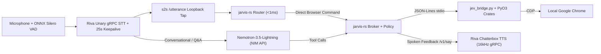

# Jarvis Full Handoff Document

> Jarvis is currently stopped cleanly (no background process running, port `127.0.0.1:8765` is free). All code changes, builds, and verification checks are complete and synced to `origin/main`.

---

## 1. Repository, Git & Runtime State

- **Workspace Path:** `C:\Users\Abish\Desktop\combinned jarvis`
- **Previous Reference Copy:** `C:\Users\Abish\Desktop\COLAB CLI\combinned jarvis`
- **GitHub Remote:** `https://github.com/hackerabi2005/ai.git` (`main`)
- **Git Author:** `hackerabi2005 <abishekji2005@gmail.com>`
- **Language Classification:** [.gitattributes](file:///c:/Users/Abish/Desktop/combinned%20jarvis/.gitattributes) marks vendored Python/demo/presentation trees so GitHub Linguist highlights the Rust crates under `jarvis-rs/` and `rust/`.
- **Recent Commit History (`main`):**
  - `a701e7f` — Fix tab switching with New Tab open and missed voice phrases from live log
  - `ba0892b` — Fix 41s Riva streaming timeout cascade with unary gRPC, 25s keepalive, and RMS silence gate
  - `fe1aabe` — Enable Riva streaming gRPC STT, switch to fast Nemotron-3.5-Lightning LLM, and clean STT search punctuation
  - `5ac0adf` — Fix Chrome auto-launch when Brave/Edge is open, process-tree shutdown, and doctor CDP check
  - `014d422` — Fix startup hangs, ONNX Silero VAD, PyO3 wiring, broker/supervisor races, and jarvis doctor
  - `90cab0e` — Add project handoff documentation (`HANDOFF.md`)

---

## 2. Architecture Overview

Both the previous copy (`COLAB CLI\combinned jarvis`) and this repo run a **hybrid Rust + Python architecture** with **100% cloud APIs for STT, LLM, and TTS** (no local STT/TTS models; only lightweight ONNX Silero VAD runs locally to detect speech endpoints).



### Core Components & Key Files

1. **Rust Supervisor, Router, Broker & CLI (`jarvis-rs/`)**
   - [Cargo.toml](file:///c:/Users/Abish/Desktop/combinned%20jarvis/jarvis-rs/Cargo.toml): Optimized `[profile.release]` (`opt-level = 3`, `lto = "thin"`, `codegen-units = 1`, `strip = "symbols"`). Both debug and release binaries (`jarvis-rs\target\release\jarvis.exe`) are built and up to date.
   - [main.rs](file:///c:/Users/Abish/Desktop/combinned%20jarvis/jarvis-rs/src/main.rs): CLI commands `doctor`, `browse`, and `run`. `jarvis doctor` checks API keys, both Python venvs, `jarvis_s2s.yaml` + PyO3 extensions, Silero ONNX cache, port `127.0.0.1:8765`, Chrome remote-debugging profile + live CDP status, `browser-harness --doctor`, and `jev_bridge` stdio ping.
   - [supervisor.rs](file:///c:/Users/Abish/Desktop/combinned%20jarvis/jarvis-rs/src/supervisor.rs): Checks port `127.0.0.1:8765` availability before spawn, starts the loopback tool API (`127.0.0.1:<ephemeral>`), injects all 9 PyO3 crates into `PYTHONPATH`, warms Chrome in a non-blocking background task (seeding initial active tab URL), spawns `speech-to-speech`, runs per-spawn `announce_when_ready` (60s window), and tears down the full Windows process tree (`kill_process_tree()` via `taskkill /T /F /PID`) on `Ctrl+C` or voice quit.
   - [router.rs](file:///c:/Users/Abish/Desktop/combinned%20jarvis/jarvis-rs/src/router.rs): `<1ms` deterministic voice router for 40+ browser, navigation, media, tab, scroll, zoom, search, and appearance commands, with STT query punctuation cleanup (`clean_search_query`) and wake-word gating (`is_addressed_to_jarvis`) so Chrome video audio does not falsely trigger conversational chat.
   - [broker.rs](file:///c:/Users/Abish/Desktop/combinned%20jarvis/jarvis-rs/src/broker.rs) & [api.rs](file:///c:/Users/Abish/Desktop/combinned%20jarvis/jarvis-rs/src/api.rs): `PipelineGuard` RAII lock preventing concurrent utterances from interleaving across multi-step voice pipelines, mid-flight `is_stop_requested()` checks in `open_url` / `click_target`, `record_initial_url()`, and `is_risky_action()` confirmation gates (checkout, purchase, payment, delete, submit, send, etc.).
   - [bridge.rs](file:///c:/Users/Abish/Desktop/combinned%20jarvis/jarvis-rs/src/bridge.rs) & [narrator.rs](file:///c:/Users/Abish/Desktop/combinned%20jarvis/jarvis-rs/src/narrator.rs): JSON-Lines stdio bridge to `jev_bridge.py` (`warm_browser` returns optional active tab URL) and TTS narration via `/v1/say`.

2. **Voice Runtime (`s2s/speech-to-speech/`) — 100% APIs for STT / LLM / TTS**
   - Config: [jarvis_s2s.yaml](file:///c:/Users/Abish/Desktop/combinned%20jarvis/jarvis-rs/config/jarvis_s2s.yaml)
     - **VAD:** Local Silero ONNX (`silero`, `smart_turn: false`, `min_speech_ms: 192`, `min_silence_ms: 64`)
     - **STT:** NVIDIA Riva NVCF Parakeet CTC unary gRPC (`use_grpc: true`, `streaming: false`, function `1598d209-5e27-4d3c-8079-4751568b1081`)
     - **LLM:** NVIDIA NIM `nvidia/nemotron-3.5-lightning-30b-a3b` (`stream: true`, `disable_thinking: true`, `max_tokens: 1024`)
     - **TTS:** NVIDIA Riva Chatterbox Multilingual gRPC (`Chatterbox-Multilingual.en-US.Male`, `16000Hz`, function `ddacc747-1269-4fab-bfd9-8f593dead106`)
   - Audio capture/playback runs in an isolated Windows spawn child process via [_audio_worker.py](file:///c:/Users/Abish/Desktop/combinned%20jarvis/s2s/speech-to-speech/src/speech_to_speech/api/openai_realtime/_audio_worker.py) (re-exported by [audio_client.py](file:///c:/Users/Abish/Desktop/combinned%20jarvis/s2s/speech-to-speech/src/speech_to_speech/api/openai_realtime/audio_client.py)).

3. **Browser Bridge & CDP Agent (`jarvis-rs/python/` + `borwse harness/jev-ultrafast/`)**
   - [jev_bridge.py](file:///c:/Users/Abish/Desktop/combinned%20jarvis/jarvis-rs/python/jev_bridge.py): Persistent CDP session manager with target-browser Chrome auto-launch, bounded `ensure_daemon` calls, fast direct DOM click matching (`match_click`), tab listing/switching/closing, scroll/zoom/media controls, and Experiential Labs `jev-latest` fallback for multi-step web tasks.
   - [jarvis_tools.py](file:///c:/Users/Abish/Desktop/combinned%20jarvis/jarvis-rs/python/jarvis_tools.py): Tool schema (`browser_task`, `browser_confirm`, `browser_control`, `read_page`) forwarding authenticated calls to `jarvis-rs`.

4. **PyO3 Rust Port Crates (`rust/`)**
   - Unified re-export library: [rust/app/src/lib.rs](file:///c:/Users/Abish/Desktop/combinned%20jarvis/rust/app/src/lib.rs) (library crate only; the runnable CLI is `jarvis-rs`).
   - All 9 crates load in `s2s` Python (`abi3-py39`), and the 4 benchmark-verified faster accelerators are wired directly into Python with `try/except ImportError` fallbacks:
     - `llm_rs` → [LLM/utils.py](file:///c:/Users/Abish/Desktop/combinned%20jarvis/s2s/speech-to-speech/src/speech_to_speech/LLM/utils.py): `remove_markdown` (`20.97×` faster on plain text, `1.44×` on markdown, `1,603/1,603` diff cases matching after byte fast-path optimization in [port.rs](file:///c:/Users/Abish/Desktop/combinned%20jarvis/rust/llm-rs/src/port.rs)) and `remove_unspeechable` (`3.84×` faster).
     - `tool_call_rs` → [function_call.py](file:///c:/Users/Abish/Desktop/combinned%20jarvis/s2s/speech-to-speech/src/speech_to_speech/LLM/tool_call/function_call.py): `find_json_tool_call_end` (`15.97×` faster).
     - `stt_rs` → [nemotron_transcribe.py](file:///c:/Users/Abish/Desktop/combinned%20jarvis/s2s/speech-to-speech/src/speech_to_speech/STT/nemotron_transcribe.py): `clean_transcript` (`6.45×` faster).
     - `tts_rs` → [persian_normalization.py](file:///c:/Users/Abish/Desktop/combinned%20jarvis/s2s/speech-to-speech/src/speech_to_speech/TTS/persian_normalization.py): `normalize` (`2.64×` faster).

---

## 3. All Bugs & Latency Issues Diagnosed and Fixed

### A. Cold Startup Speed (`29.14s` → `4.67s`) & Clean Shutdown
- **Eliminated PyTorch Import on Startup ([vad_iterator.py](file:///c:/Users/Abish/Desktop/combinned%20jarvis/s2s/speech-to-speech/src/speech_to_speech/VAD/vad_iterator.py), [vad_handler.py](file:///c:/Users/Abish/Desktop/combinned%20jarvis/s2s/speech-to-speech/src/speech_to_speech/VAD/vad_handler.py), [s2s_pipeline.py](file:///c:/Users/Abish/Desktop/combinned%20jarvis/s2s/speech-to-speech/src/speech_to_speech/s2s_pipeline.py)):**
  - Added pure-NumPy `SileroOnnxModel` backed by `onnxruntime` (`max_diff = 4.23e-06` vs PyTorch JIT, matching trigger parity) and lazy `torch` fallback.
  - Cold `build_configured_server()` dropped from `29.14s` to `4.67s` with `torch_loaded=False`.
  - Fixed stale references in `s2s_pipeline.py` to deleted `diarization`, `STV.w2v_stv_handler`, and `TTS.phonon_tts_handler`, and guarded `HfArgumentParser` under `TYPE_CHECKING`.
- **Isolated Audio Spawn Worker ([_audio_worker.py](file:///c:/Users/Abish/Desktop/combinned%20jarvis/s2s/speech-to-speech/src/speech_to_speech/api/openai_realtime/_audio_worker.py), [audio_client.py](file:///c:/Users/Abish/Desktop/combinned%20jarvis/s2s/speech-to-speech/src/speech_to_speech/api/openai_realtime/audio_client.py), [cli.py](file:///c:/Users/Abish/Desktop/combinned%20jarvis/s2s/speech-to-speech/src/speech_to_speech/cli.py)):**
  - Moved child-process audio streaming into lightweight `_audio_worker.py` (`0.227s` import vs `1.703s` for `audio_client.py`) and restored `echo_cancellation=config.echo_cancellation` passthrough.
- **Background Warmup & Thread-Safe Shutdown ([riva_stt_handler.py](file:///c:/Users/Abish/Desktop/combinned%20jarvis/s2s/speech-to-speech/src/speech_to_speech/STT/riva_stt_handler.py), [riva_tts_handler.py](file:///c:/Users/Abish/Desktop/combinned%20jarvis/s2s/speech-to-speech/src/speech_to_speech/TTS/riva_tts_handler.py), [chat_completions_language_model.py](file:///c:/Users/Abish/Desktop/combinned%20jarvis/s2s/speech-to-speech/src/speech_to_speech/LLM/chat_completions_language_model.py), [base_openai_compatible_language_model.py](file:///c:/Users/Abish/Desktop/combinned%20jarvis/s2s/speech-to-speech/src/speech_to_speech/LLM/base_openai_compatible_language_model.py)):**
  - Moved STT/TTS/LLM warmups off the startup critical path onto tracked daemon threads guarded by `_closed` events + `join(timeout=1.0)` on `cleanup()`, eliminating cross-thread `asyncio.Runner` cleanup errors and CPython `_enter_buffered_busy` stderr crashes at exit.
- **Windows Process-Tree Teardown ([supervisor.rs](file:///c:/Users/Abish/Desktop/combinned%20jarvis/jarvis-rs/src/supervisor.rs)):**
  - Added `kill_process_tree()` (`taskkill /T /F /PID`) so exiting via `Ctrl+C` or voice quit terminates both `s2s` and its spawned `_AudioWorker` child without leaving port `127.0.0.1:8765` locked.

### B. Voice API Latency Fixes (STT `41s` Cascade → `~440ms`, LLM `>16s Timeout` → `658ms` TTFT)
- **Riva STT API ([riva_stt_handler.py](file:///c:/Users/Abish/Desktop/combinned%20jarvis/s2s/speech-to-speech/src/speech_to_speech/STT/riva_stt_handler.py), [jarvis_s2s.yaml](file:///c:/Users/Abish/Desktop/combinned%20jarvis/jarvis-rs/config/jarvis_s2s.yaml)):**
  - Live log `task-742.log` showed NVIDIA NVCF Parakeet CTC `StreamingRecognize` timing out on 100% of live turns (`turn_1`, `turn_5`, `turn_12`, `turn_16`), resetting the shared channel (`CANCELLED: Channel closed!`) and cascading into 41-second retry chains.
  - Kept `riva_stt_streaming: false` (unary gRPC), added a **`0.12ms` RMS silence gate** (`rms < 0.004`) to skip API calls on mic noise, added a **`25s` background gRPC keepalive ping** (`riva-stt-keepalive`) to keep the remote NVCF worker hot, and replaced the multi-stage HTTP fallback loop with a bounded `8.0s` unary gRPC timeout + single fresh-channel retry.
  - Verified live unary STT latency: **`438ms` / `445ms`** for `'Go to Youtube.'`, and **zero** STT timeouts across the entire `task-803.log` live session.
- **NIM LLM API ([jarvis_s2s.yaml](file:///c:/Users/Abish/Desktop/combinned%20jarvis/jarvis-rs/config/jarvis_s2s.yaml), [chat_completions_language_model.py](file:///c:/Users/Abish/Desktop/combinned%20jarvis/s2s/speech-to-speech/src/speech_to_speech/LLM/chat_completions_language_model.py)):**
  - Replaced timing-out `nvidia/nemotron-3-ultra-550b-a55b` (`>16s ReadTimeout`, 96s warmup retries) with **`nvidia/nemotron-3.5-lightning-30b-a3b`** (`658ms` streaming TTFT / `698ms` total, verified `HTTP 200` with `jarvis_tools`) and capped warmup to `max_retries=1, timeout=8.0s`.
- **Utterance Tap Retry ([websocket_router.py](file:///c:/Users/Abish/Desktop/combinned%20jarvis/s2s/speech-to-speech/src/speech_to_speech/api/openai_realtime/websocket_router.py)):**
  - Retries `/utterance` once with a fresh `httpx2.AsyncClient` on `httpx2.TransportError`.

### C. Chrome Connection, Tab Switching & Voice Routing Fixes
- **Target-Browser Chrome Auto-Launch ([jev_bridge.py](file:///c:/Users/Abish/Desktop/combinned%20jarvis/jarvis-rs/python/jev_bridge.py)):**
  - Previously, having Brave (`brave.exe`) open made `browser_harness.daemon.supported_browser_running()` return `True`, causing `_ensure_chrome_running()` to skip launching Chrome and fail every `"open youtube"` command with `chrome_not_ready`.
  - Rewrote `_ensure_chrome_running()` to check `_devtools_port_live` and the specific target executable (`_is_target_browser_running`, e.g. `chrome.exe`), auto-launching Google Chrome even when Brave/Edge is running.
  - Bounded `ensure_daemon` calls (`4.0s` in `warm_browser`, `10.0s` in `_open`) so Chrome's `"Allow remote debugging?"` prompt never deadlocks `StdioBridge`, removed duplicate `ensure_daemon` calls in `_try_attach_existing_tab(ensure=False)`, seeded `Broker.record_initial_url()`, and dispatched `press_enter` with the `\r` `char` CDP event.
- **Tab Switching With `New Tab` Open ([jev_bridge.py](file:///c:/Users/Abish/Desktop/combinned%20jarvis/jarvis-rs/python/jev_bridge.py)):**
  - Live log `task-803.log` showed `"Only one tab is open."` when both `New Tab` and `YouTube` were open because `_list_page_targets()` excluded `chrome://new-tab-page` and `_switch_tab()` passed `prefer_real=True`.
  - Included `chrome://new-tab-page` in `_list_page_targets()` and switched `_switch_tab()` to `prefer_real=False`.
- **Voice Router & Concurrency ([router.rs](file:///c:/Users/Abish/Desktop/combinned%20jarvis/jarvis-rs/src/router.rs), [broker.rs](file:///c:/Users/Abish/Desktop/combinned%20jarvis/jarvis-rs/src/broker.rs), [api.rs](file:///c:/Users/Abish/Desktop/combinned%20jarvis/jarvis-rs/src/api.rs)):**
  - Added `clean_search_query()` (`"Search mr.. beast."` → `"mr beast"`, preserving `"node.js"`).
  - Added missed live phrases from `task-803.log`: `"bro "`/`"yo "`/`"hello. "` prefixes in `strip_polite_prefix`, `"skip that"` in `SKIP_AD_RE`, `"pause the video. the video"` in `PAUSE_VIDEO_RE`, and `"what is this tab?"` / `"which tab is this?"` in `LIST_TABS_RE`.
  - Added `PipelineGuard` concurrency locking across `RouteAction::Pipeline` and mid-flight `is_stop_requested()` checks in `open_url` / `click_target`.

---

## 4. Latest Verified Check Results (on `a701e7f`)

| Check | Result |
|---|---|
| `cargo test --manifest-path jarvis-rs/Cargo.toml` | **30 passed** (`10` unit + `20` integration), `0` failed |
| `cargo clippy --all-targets --manifest-path jarvis-rs/Cargo.toml -- -D warnings` | Passed (`0` warnings) |
| `cargo build` & `cargo build --release` (`jarvis-rs`) | Both succeeded |
| `cargo test --workspace --manifest-path rust/app/Cargo.toml` | Passed (`0` failed) |
| All 9 `rust/*-rs` crates `cargo test` (`llm-rs` `5/5`, `1,603/1,603` diff cases) | Passed |
| `test_jev_bridge.py` (`jev` venv Python) | **20 passed**, `0` failed (`0.54s`) |
| `test_jarvis_tools.py` (`s2s` venv Python) | **3 passed**, `0` failed (`4.47s`) |
| `ruff check --select E9,F63,F7,F82` (all Python trees) | `All checks passed!` |
| `jarvis.exe doctor` | Exited `0` (keys set, venvs ok, YAML + PyO3 ok, ONNX found, port `8765` available, `cdp_live=True`, `chrome running`, `jev_bridge ping: ok`) |

---

## 5. Operations Runbook

### Environment Variables (Never Commit Secrets)
Loaded automatically by [config.rs](file:///c:/Users/Abish/Desktop/combinned%20jarvis/jarvis-rs/src/config.rs) from `jarvis-rs/.env`, `s2s/speech-to-speech/.env`, and `borwse harness/jev-ultrafast/.env`:
- `NVIDIA_API_KEY` (Riva STT, Riva TTS, NIM LLM)
- `EXPERIENTIAL_API_KEY` (Jev browser agent)
- `TEXT_MODEL_API_KEY` (Jev text model)

### Run Jarvis (Recommended Release Binary)
```powershell
cd "C:\Users\Abish\Desktop\combinned jarvis"
.\jarvis-rs\target\release\jarvis.exe run
```
1. If Chrome shows **"Allow remote debugging?"**, click **Allow** once.
2. Wait for `Ready — start speaking.` / `ASSISTANT: Jarvis ready.`.
3. **Browser commands** work directly without a wake word (e.g., *"Open YouTube"*, *"Search MrBeast"*, *"Open another tab"*, *"Go to previous tab"*, *"Close this tab"*, *"Scroll down"*, *"Skip that"*, *"Pause the video"*, *"What is this tab?"*, *"Stop"*).
4. **General conversation / Q&A** requires addressing Jarvis (e.g., *"Jarvis, hello how are you?"*) to open a 12-second chat window while preventing Chrome video audio from triggering replies.
5. **Quit** with `Ctrl+C` or by saying **"Jarvis, quit"**.

### Run Diagnostics & Full Test Suite
```powershell
# System health & config check
.\jarvis-rs\target\release\jarvis.exe doctor

# Rust checks & builds
cargo clippy --all-targets --manifest-path "jarvis-rs\Cargo.toml" -- -D warnings
cargo test --manifest-path "jarvis-rs\Cargo.toml"
cargo build --release --manifest-path "jarvis-rs\Cargo.toml"
cargo test --workspace --manifest-path "rust\app\Cargo.toml"

# Python checks (invoke venv python directly so copied .exe shebangs aren't used)
& "borwse harness\jev-ultrafast\.venv\Scripts\python.exe" -m pytest "jarvis-rs\python\test_jev_bridge.py" -v
& "s2s\speech-to-speech\.venv\Scripts\python.exe" -m pytest "jarvis-rs\python\test_jarvis_tools.py" -v
& "s2s\speech-to-speech\.venv\Scripts\python.exe" -m ruff check --select E9,F63,F7,F82 "jarvis-rs\python" "borwse harness\jev-ultrafast\jev_ultrafast" "s2s\speech-to-speech\src"
```

---

## 6. Known Notes & Future Options

1. **Venv `.exe` Shebangs:** Because `.venv` folders were copied across directories, always invoke `...\Scripts\python.exe -m pytest` (as `jarvis-rs` does when spawning `python.exe -m ...`) rather than `pytest.exe` directly.
2. **Optional `webrtc_session.py`:** Requires `av` (PyAV), which is intentionally omitted since `jarvis_s2s.yaml` uses the local loopback WebSocket audio client (`audio_client.py`).
3. **Chrome Per-Session Debug Approval:** Chrome 144+ prompts **"Allow remote debugging?"** once per browser launch; click **Allow** once and the daemon stays attached for the rest of the Chrome session.
4. **Even Lower-Latency LLM Option:** `nvidia/nemotron-3.5-bolt-e4b` was also benchmarked live on the same `NVIDIA_API_KEY` (`579ms` TTFT vs `658ms` for `nemotron-3.5-lightning-30b-a3b`) if you ever want a lighter conversational model in [jarvis_s2s.yaml](file:///c:/Users/Abish/Desktop/combinned%20jarvis/jarvis-rs/config/jarvis_s2s.yaml).
5. **YouTube Lazy-Loaded Comments:** On YouTube watch pages, `"Add a comment"` is below the fold until scrolled down once (`"Scroll down"`, then `"Add a comment"`).
